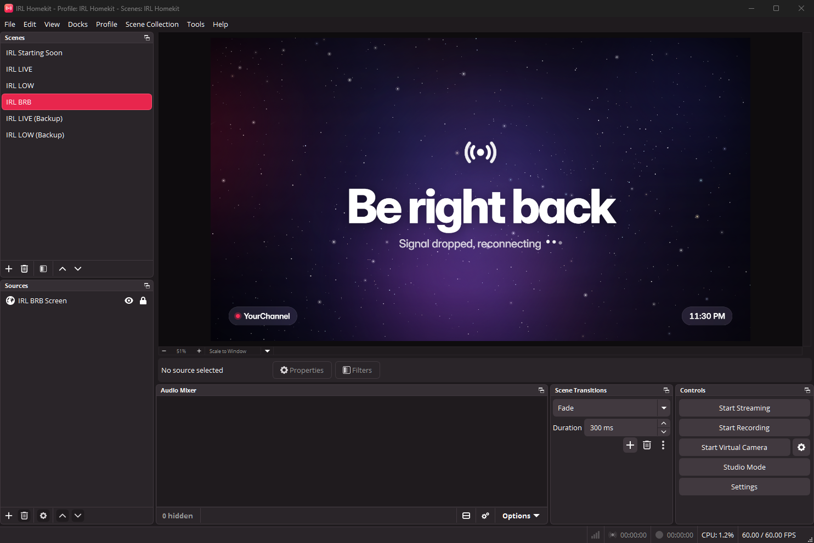
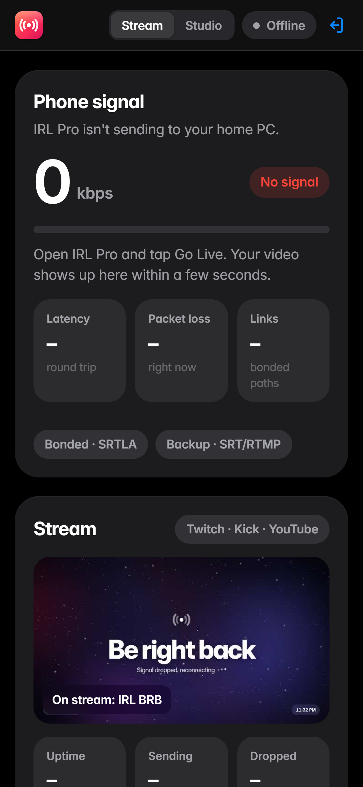
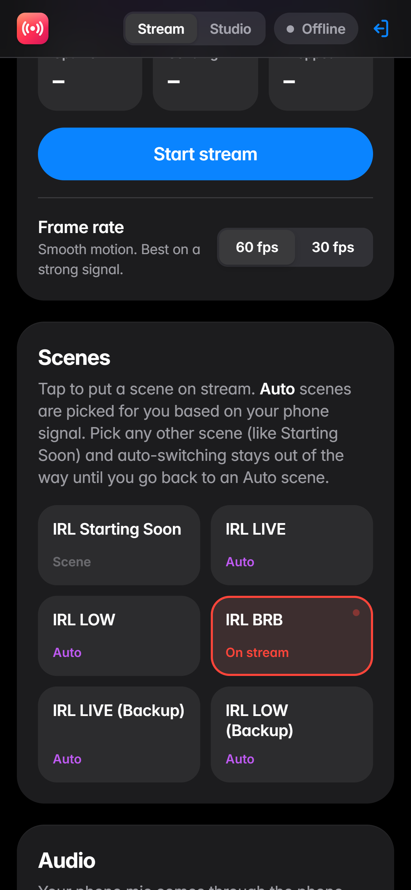

# IRL Homekit

> **Beta.** IRL Homekit works end to end, but it's new: expect some rough edges. Please report anything odd on the
> [issues page](https://github.com/CursedByJava/irl-homekit/issues) (Start menu → *IRL Homekit - Save diagnostics*
> makes a zip to attach). What changed in each version: [CHANGELOG.md](CHANGELOG.md).

**Self-hosted IRL streaming from your own Windows PC: a free alternative to IRL Toolkit / cloud OBS.**

Your phone (IRL Pro, Moblin, BELABOX) sends a bonded 5G + Wi-Fi stream to the PC at home. IRL Homekit's own copy of
OBS adds your overlays, automatically drops to a "low signal" or "be right back" scene when your connection
struggles, and sends 1080p60 to Twitch, Kick and YouTube at the same time. A mobile web dashboard lets you watch your
signal and control everything from the street.

```
Phone (IRL Pro, bonded 5G + Wi-Fi)
   │  SRTLA → UDP 5000          backup: SRT → UDP 8890 / RTMP → TCP 1935
   ▼
Home PC ── go-irl (bonded receiver) ──┐
        ── MediaMTX (backup receiver) ┤→ IRL Homekit OBS  ── Twitch
        ── NOALBS (auto scene switch) ┘   LIVE / LOW / BRB ── Kick     (obs-multi-rtmp)
        ── Dashboard + Caddy (HTTPS) ← you, on your phone  ── YouTube  (obs-multi-rtmp)
```

<p align="center">
  
</p>
<p align="center">
  
  &nbsp;&nbsp;
  
</p>
<p align="center"><sub>The IRL Homekit OBS (top) and the remote dashboard on a phone (bottom).</sub></p>
## What you get

| | IRL Toolkit-style feature | How |
|---|---|---|
| ✅ | An app you open and close, with its own OBS, separate from your regular OBS | portable OBS Studio in IRL Homekit's colours |
| ✅ | Bonded cellular + Wi-Fi ingest (SRTLA) | [go-irl](https://github.com/e04/go-irl) |
| ✅ | Backup SRT / RTMP ingest | [MediaMTX](https://github.com/bluenviron/mediamtx), password protected |
| ✅ | Auto LIVE / LOW / BRB scenes, `!bitrate` `!start` `!stop` chat commands | [NOALBS](https://github.com/NOALBS/nginx-obs-automatic-low-bitrate-switching) |
| ✅ | Multistream Twitch + Kick + YouTube (+ any custom RTMP destination) without Restream, each switchable on the dashboard | [obs-multi-rtmp](https://github.com/sorayuki/obs-multi-rtmp) |
| ✅ | Remote control page with live signal, preview, start/stop, scenes, mute | `dashboard/` (Node, no dependencies) |
| ✅ | Studio page: combined Twitch/Kick/YouTube chat, viewers, title & category everywhere | `dashboard/` + official platform APIs |
| ✅ | Animated 1080p Starting Soon and Be Right Back screens, live "low bitrate" warning (small, bottom-left) | `overlays/` (OBS browser sources) |
| ✅ | Free HTTPS on your own domain | [Caddy](https://caddyserver.com) + Let's Encrypt |
| ✅ | No port forwarding and no accounts for most people: IRL Homekit opens its ports on your router by itself | UPnP / NAT-PMP, `scripts/Set-IRLPortMap.ps1` |
| ✅ | Internet that can't take incoming streams (carrier-grade NAT, some 5G home internet, Starlink): a free relay server in front of your PC, also hides your home IP | [WireGuard](https://www.wireguard.com) to a VM on Oracle Cloud Always Free, see [RELAY.md](docs/RELAY.md) |
| ✅ | A normal Windows setup wizard | `installer/` ([Inno Setup](https://jrsoftware.org/isinfo.php)) |
| ✅ | Starts with Windows (optional), restarts anything that crashes | `scripts/Start-IRLHomekit.ps1` |

Cost: $0/month. Uses your home upload (about 8 Mbps per platform). Like it? [Support the project](#support-the-project).

## Requirements

- Windows 10/11 PC with a decent GPU (NVIDIA/AMD encoder recommended). You **don't** need OBS installed:
  IRL Homekit brings its own copy. If you already use OBS, the installer can copy your scenes and settings from it.
- Windows 11 *Smart App Control* must allow IRL Homekit's open-source tools. The installer checks this and tells you if it
  doesn't ([details](docs/TROUBLESHOOTING.md#windows-blocks-the-tools-smart-app-control)).
- A home connection with a **public IPv4** (most fiber, cable and DSL). IRL Homekit asks your router to open its
  ports by itself (UPnP, on by default on most home routers), so there's usually nothing to set up. If the router
  doesn't do that, you forward the ports by hand ([ROUTER.md](docs/ROUTER.md)). If your provider shares one address
  between homes (carrier-grade NAT; Setup tells you), use a free relay server instead ([RELAY.md](docs/RELAY.md))
- Optional, to reach the dashboard from your phone anywhere: a **free** name from [DuckDNS](https://www.duckdns.org) or a
  domain you own (about $10/year). A guided setup does the rest: see [Remote dashboard](#remote-dashboard).
- Optional for the self-test: ffmpeg, `winget install Gyan.FFmpeg`

Nothing else to install: IRL Homekit brings its own copy of Node.js (for the dashboard) if your PC doesn't have it.

## Install

**Easiest:** download **`IRL-Homekit-Setup-<version>.exe`** from the [latest release](https://github.com/CursedByJava/irl-homekit/releases)
and run it. It's a normal setup wizard: your channels (all optional: skip them and add them later), an optional
custom destination, which OBS scenes and overlays to bring over, a dashboard login, how your phone reaches the PC
(through your home router, which IRL Homekit opens by itself, or a relay server), the remote dashboard, and start
with Windows. Then it installs everything with a progress bar and shows your login and next steps. Running it again
updates IRL Homekit and keeps your settings, or changes your channels and connection if you tick those boxes.
(Setup.exe isn't code-signed yet, so Windows may say "unknown publisher": **More info → Run anyway**. On PCs with
Smart App Control on, Windows can block it outright: then use the one-line install below, which does exactly
the same.)
Run it while signed in to the Windows account you stream from, and make that an administrator account: if Windows
asks for a *different* account's password, IRL Homekit gets set up for that account instead.

**Or with one line** (nothing to download by hand, and Smart App Control has nothing to block): right-click the
Start button → **Terminal** (or open **PowerShell**), paste this and press Enter:

```powershell
irm https://raw.githubusercontent.com/CursedByJava/irl-homekit/main/get.ps1 | iex
```

It downloads the newest release from GitHub ([get.ps1](get.ps1), short enough to read first) and starts the
installer: click **Yes** when Windows asks for permission, then answer its questions in the window that opens (the
same ones as in step 2 below). Running it again updates IRL Homekit.

**Or from the source code** (same result, questions in a console window):

1. Download this repo: green **Code** button → **Download ZIP**, then right-click the ZIP → **Extract All**.
2. Open the extracted folder and double-click **`Install IRL Homekit.cmd`**.
   - Windows asks for administrator permission: click **Yes**. (If SmartScreen says "Windows protected your PC",
     click **More info → Run anyway**: the file is a two-line launcher for `install.ps1`, which you can read.)
   - The installer asks a few questions: your channels (press Enter to skip any), whether to copy your regular OBS (everything, or just
     one scene collection), which chat/alert overlays to show, a dashboard password, whether to start with Windows (yes by default), and whether to set up the
     [remote dashboard](#remote-dashboard).
   - When it's done, IRL Homekit opens.
3. Open `C:\IRLHomekit\PHONE-SETUP.md`. It has **your** IRL Pro settings, passwords and the last manual steps:
   your Twitch stream key, optional Kick/YouTube keys, and router port forwarding only if your router couldn't open
   the ports by itself ([ROUTER.md](docs/ROUTER.md)).
   Need the IRL Pro settings again later? They're on the dashboard (**Phone settings** → Show, with copy buttons) and in
   Start menu → *IRL Homekit - Status*.
4. Go live from your phone with Wi-Fi off to prove it works from outside.

**Updating:** IRL Homekit tells you when there's a new version (see [Updates](#updates)). You can also download the new
version and double-click `Install IRL Homekit.cmd` again. Your answers, passwords, stream keys and settings are kept.

<details><summary>Prefer the command line?</summary>

From an administrator PowerShell in the folder:

```powershell
powershell -ExecutionPolicy Bypass -File .\install.ps1
```

Options (all optional): `-InstallDir`, `-TwitchChannel`, `-Domain`, `-DashboardUser`, `-BaseCollection`,
`-BaseProfile`, `-ImportObs`, `-AutoStart On|Off`, `-PortMap Auto|Off` (router ports), `-RelayHost`, `-BaseObsConfigDir`, `-DuckDnsName`, `-DuckDnsToken`,
`-OverlaySources "Chat,Alerts"`, `-BrbBackground "<media source>"`, `-ObsName`, `-NonInteractive`.
</details>

## Using the app

IRL Homekit is an app with its own OBS. Your regular OBS is never changed, and you can still use it for desktop
streams (close IRL Homekit first so the two don't compete for your graphics card).

- **Open it:** the **IRL Homekit** icon on the desktop or in the Start menu. Its OBS opens with the IRL scenes, plus
  the dashboard and Studio as panels, and the phone receivers start in the background.
- **Close it:** close the IRL Homekit OBS window. Everything stops: receivers, auto-switcher, dashboard. If the OBS
  window is hidden, it's in the tray: right-click the OBS icon there → **Exit**.
- **If it crashes,** OBS and every part restart by themselves.
- **It runs as administrator,** which gives OBS priority on your graphics card (fewer skipped frames when the PC is
  busy). You won't see a permission prompt each time: the installer sets this up once with two Windows tasks
  (*IRL Homekit* and *IRL Homekit (sign-in)* in Task Scheduler). One side effect: you can't drag files from
  Explorer into this OBS (a Windows rule for admin apps); use **+** in Sources instead.
- **Looks different on purpose:** the IRL Homekit OBS uses its own skin (OBS's normal dark theme in IRL Homekit's
  red-pink colours) and shows "IRL Homekit" in its title bar and taskbar, so you can't mix it up with your regular OBS.
- **Import from your regular OBS** any time: Start menu → **IRL Homekit - Import from OBS** copies all your
  profiles, scene collections, settings and (same OBS version) plugins. Your IRL Homekit setup is kept, and the
  previous settings are backed up first.
- **Other tools** in the Start menu folder *IRL Homekit*: Status, Update scenes, Set up remote dashboard, Twitch chat
  token, Change login, Check for updates, Save diagnostics, Uninstall.

### Start with Windows (on by default)

> **IRL Homekit opens by itself, minimized, when you sign in to Windows.** That way the dashboard is always there
> when you're out and want to go live from your phone. It's on by default; the installer asks, and you can turn it
> off any time on the dashboard: **Home PC → Start with Windows**.

- When it's off, IRL Homekit only runs while you have it open, and after a restart the dashboard is offline until
  someone opens IRL Homekit on the PC.
- It starts when you **sign in**, not when the PC powers on. For a PC that comes back by itself after a power cut,
  also turn on Windows automatic sign-in (steps in `PHONE-SETUP.md`).

### Updates

IRL Homekit updates itself like other apps:

- **When you open it** (at most once a day), it checks GitHub for a newer version. If there is one, Windows asks
  **"Update now?"** with what's new.
- **On the dashboard**, an *Update available* banner appears with an **Update** button, so you can update from your
  phone too (not while you're live).
- **Any time:** Start menu → *IRL Homekit - Check for updates*.

Updating downloads the release, closes IRL Homekit, runs the installer with your saved answers (it asks nothing),
and reopens IRL Homekit, in about 2 minutes. While IRL Homekit is a beta you get beta updates; set
`"updateChannel": "stable"` in `C:\IRLHomekit\settings.json` to wait for stable releases only.

### Uninstall

**Settings → Apps → IRL Homekit → Uninstall** (or Start menu → *IRL Homekit - Uninstall*). It closes IRL Homekit
and removes its shortcuts, tasks, firewall rules and app entry, and asks whether to delete `C:\IRLHomekit` too.
Your regular OBS isn't touched. Router ports IRL Homekit opened itself are closed again; if you forwarded ports by
hand, remove those forwards on your router (or delete the relay VM in Oracle Cloud if you used one).
## Remote dashboard

Reach your dashboard and Studio from your phone anywhere at `https://your-name...`, with a free HTTPS certificate.
Start menu → **IRL Homekit - Set up remote dashboard** (the installer offers it too) and pick one:

| Choice | You get | Cost | What you do |
|---|---|---|---|
| **1. Free DuckDNS name** (recommended) | `https://yourname.duckdns.org` | Free | Sign in at [duckdns.org](https://www.duckdns.org) (it opens for you), add a name, paste the token |
| **2. A domain you own** | `https://irl.yourname.com` | ~$10/year ([cheap registrars](docs/DOMAIN.md#option-2-your-own-domain)) | Add the two DNS records it shows you (GoDaddy, Cloudflare, Namecheap and Porkbun steps included) |
| **3. This PC only** | `http://localhost:8090` | Free | Nothing |

Then it sets up the web server and firewall and **checks everything for you**, with a plain fix for anything that
isn't right yet:

- the name points to your home IP (it waits while new DNS records appear)
- your router forwards ports 80 and 443 (it offers to open your router's page, see [ROUTER.md](docs/ROUTER.md)), or,
  with a relay server, that the relay lets them in ([RELAY.md](docs/RELAY.md))
- the free HTTPS certificate was issued

Run it again any time to re-check or switch. The dashboard's *Home PC* card also shows **Remote access**: working, or
what to fix. With DuckDNS, IRL Homekit keeps your name pointed at your home IP and your phone settings use the name,
so an IP change never breaks anything. More detail: [docs/DOMAIN.md](docs/DOMAIN.md).

## Signing in

One login opens both the dashboard and Studio.

- **First install:** the installer asks you for a username (default: your Twitch channel) and a password. Press
  Enter at the password prompt and it makes a strong one for you. You'll see the login at the end of the install,
  and it's saved in `C:\IRLHomekit\PHONE-SETUP.md`.
- **Sign in once for both pages:** signing in to the dashboard also signs you in to Studio, and the other way round.
- **Stay signed in:** *Keep me signed in* is ticked by default, so you stay signed in as long as you open it at least
  once every 30 days. Untick it on a phone that isn't yours: you're signed out when that browser closes.
- **Change it or forgot it:** on the PC, Start menu → **IRL Homekit - Change login**. Pick a
  new username/password; every device is signed out and `PHONE-SETUP.md` is updated. No restart needed.

## Dashboard

`https://your-domain` (or `http://localhost:8090` on the PC). Mobile-first and readable outdoors:

- **Phone signal:** bitrate, latency, packet loss, each bonded link, which input is active, in plain words ("Weak: viewers see the LOW SIGNAL banner")
- **Stream to:** switch Twitch, Kick, YouTube and your custom destination (any RTMP server, like Restream or
  Facebook, set up in Setup) on or off. Off means it never goes live there (no stray notifications); all but Twitch
  can be added or dropped mid-stream.
- **Stream:** live preview, uptime, outgoing bitrate, dropped frames, live outputs, Start/End with confirmation,
  one-tap 60 / 30 fps switch (while offline)
- **Scenes:** one tap; auto-switched scenes are labelled
- **Audio:** mute the phone mic remotely
- **Quick fixes:** reload a frozen feed, reload chat/alerts, recording. The phone feed is also rebuilt automatically
  every time the phone reconnects, so a codec or resolution change on the phone never leaves OBS showing garbage
- **Home PC:** health of each service with restart buttons, and the **Start with Windows** switch
- **Auto-switch history**

Security: HTTPS only, scrypt-hashed password, HttpOnly/Secure/SameSite=Lax session cookie (renews with use), 15-minute lockout
after 5 failed sign-ins, strict CSP, API bound to localhost behind Caddy.

## Studio: your channels in one place

`https://studio.your-domain` (same login) is the control room for your channels:

- **Live status and viewers** on Twitch, Kick and YouTube, plus a combined total
- **Combined chat** from all three, colour-coded, with sending to any or all platforms
- **Title and category** updated on every connected platform at once
- **Links** to platform-only settings, e.g. Twitch's go-live notification

Connecting Kick and YouTube uses your own free developer app on each platform. See
[docs/PLATFORMS.md](docs/PLATFORMS.md).

## How it works

| Piece | Port | Notes |
|---|---|---|
| go-irl | UDP 5000 (public) → UDP 5002 (local, OBS) | Encrypted with a generated passphrase |
| MediaMTX | UDP 8890 SRT, TCP 1935 RTMP (public); API 127.0.0.1:9997 | Publishing and reading need a user/password; RTSP/HLS/WebRTC off |
| IRL Homekit OBS | WebSocket 4456 (not forwarded) | Portable OBS Studio in `C:\IRLHomekit\obs`; NOALBS + dashboard control it through its WebSocket (4456, so it never clashes with your regular OBS on 4455) |
| NOALBS | — | Reads go-irl/MediaMTX stats; LOW < 1000 kbps, BRB < 300 kbps; ends stream after 20 min on BRB |
| Dashboard | 127.0.0.1:8090 | `dashboard/server.mjs`, Node built-ins only |
| Caddy | TCP 443/80 (public) | Automatic Let's Encrypt certificate |
| Router ports | UPnP / NAT-PMP to your router (local network only) | `scripts/Set-IRLPortMap.ps1` opens the public ports above on your router for 2 hours at a time and the app renews them while it runs; off with a relay. Status and the dashboard show the result |
| Relay tunnel (optional) | outgoing UDP 51820 to your relay | Only with a relay server ([RELAY.md](docs/RELAY.md)): a WireGuard tunnel (Windows service); the relay receives the public ports above and passes them to this PC |
| App | — | `scripts/Start-IRLHomekit.ps1`: opens the OBS, keeps every part running, stops everything when the OBS closes |

Files after install (`C:\IRLHomekit`): `secrets.json` (generated passwords, **never share**), `settings.json`,
`PHONE-SETUP.md`, `logs\`, `obs\` (the IRL Homekit OBS and its settings), plus each tool's folder. Your regular OBS is
never modified.

## Version history

Every change is listed in [CHANGELOG.md](CHANGELOG.md), and every version is on the
[Releases page](https://github.com/CursedByJava/irl-homekit/releases). The installed version is shown on the
dashboard (*Home PC*) and in Settings → Apps.

<details><summary>Releasing a new version (for maintainers)</summary>

1. Put the version in `VERSION` (e.g. `1.0.0-beta.2`, or `1.0.0` for stable).
2. In `CHANGELOG.md`, move the *Unreleased* notes under a new `## [1.0.0-beta.2] - YYYY-MM-DD` heading.
3. Commit and push to `main`.

The *Release* workflow sees the new `VERSION`, creates the tag and publishes the GitHub release with those notes
(betas as pre-releases), and every installed copy offers the update.
</details>

## Troubleshooting

See [docs/TROUBLESHOOTING.md](docs/TROUBLESHOOTING.md). Questions or want to share your setup? Ask in
[Discussions](https://github.com/CursedByJava/irl-homekit/discussions). Found a bug? [Report it](https://github.com/CursedByJava/irl-homekit/issues/new/choose).
Security problem? See [SECURITY.md](SECURITY.md).

## Privacy

IRL Homekit has no telemetry, analytics or accounts of its own, and no server of ours is involved: everything runs
on your PC (and your relay VM, if you use one). Your settings, passwords and tokens stay in `C:\IRLHomekit`.
It only connects to:

- **GitHub** (api.github.com): to check for a newer IRL Homekit version, when the app opens (once a day) and on the
  dashboard. Installing also downloads the tools from their official release pages (GitHub, nodejs.org,
  download.wireguard.com for the optional relay).
- **ipify** (api.ipify.org): to read your home's public IP address, for your phone settings and the remote-access checks.
- **DuckDNS** (duckdns.org): only if you use a DuckDNS name, to keep it pointed at your PC or relay.
- **Let's Encrypt**: only with the remote dashboard, for its HTTPS certificate (through Caddy).
- **Twitch, Kick, YouTube / Google**: only for the platforms you connect in Studio, to show live status, chat and
  titles; and TwitchTokenGenerator (twitchtokengenerator.com) to refresh the Twitch chat token if you set it up.
- **Your home router**: to open IRL Homekit's ports (UPnP / NAT-PMP). This stays inside your home network.
- **Your phone and your relay VM**: the stream itself.

The privacy policy for the Studio sign-ins (YouTube and Kick) is built in at `https://studio.<your-domain>/privacy`.

## Support the project

IRL Homekit is free and always will be. If it saves you a monthly bill and you'd like to say thanks, you can chip
in here. Every bit helps keep it maintained.

| | |
|---|---|
| ☕ Ko-fi | [ko-fi.com/cursedbyjava](https://ko-fi.com/cursedbyjava) |
| 💖 GitHub Sponsors | [github.com/sponsors/CursedByJava](https://github.com/sponsors/CursedByJava) |
| 💵 Cash App | [$DigitalContentSpace](https://cash.app/$DigitalContentSpace) |

Not in a position to give? A ⭐ on the repo or sharing it with another IRL streamer helps just as much.

## Credits

Built on great open-source projects: go-irl (AGPL-3.0), MediaMTX (MIT), NOALBS (MIT), obs-multi-rtmp (GPL-2.0),
Caddy (Apache-2.0), OBS Studio (GPL-2.0). The installer downloads their official releases and verifies their
checksums; this repo doesn't redistribute their binaries. See [THIRD-PARTY-NOTICES.md](THIRD-PARTY-NOTICES.md).

## License

MIT, see [LICENSE](LICENSE). Applies to the scripts and dashboard in this repo only.
